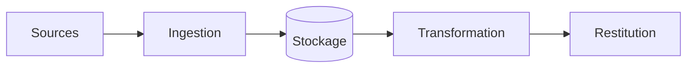

# Entrepôt de Données 
---


Les données publiques sénégalaises sont éparpillées (HDX, Banque mondiale, PAM, ANSD), dans des formats hétérogènes et sans indication de fraîcheur. Ce projet construit l’entrepôt fiable sur lequel s’appuient « Prix alimentaires », « Mobile money » et « Prévision des prix », plus un catalogue public qui dit ce qui existe, à quelle date et avec quelle qualité.

## Résultat

Le chiffre ou la capture qui montre que ça marche (à remplir à la fin).

## Architecture



## Lancer le projet

### Prérequis

- Python 3.12+
- [uv](https://docs.astral.sh/uv/)
- Make

### Installation et exécution

Depuis la racine du dépôt :

```bash
make install
make dbt-build
```

La commande `make dbt-build` construit les modèles dbt dans DuckDB et exécute les tests associés.

### Vérifications

Pour exécuter les contrôles de qualité du code et des données :

```bash
make check
```

Cette commande lance Ruff, pytest et dbt build.

## Modélisation des données

Les modèles sont organisés selon une approche dimensionnelle : tables de faits et dimensions, avec un grain défini pour chaque source.

Les choix de modélisation sont documentés dans les fichiers correspondants, voir `docs/modele.md` et/ou `models/staging/_stg_*.yml`.

## Décisions

Les choix importants et leur raison sont dans `docs/decisions.md`.

## Limites

Ce que le projet ne fait pas, et pourquoi.
Le projet présente actuellement plusieurs limites :

- **Couverture des données :** les analyses dépendent de la disponibilité, de la fréquence de publication et de la qualité des données fournies par les sources externes (HDX, ANSD, Banque mondiale).
- **Fraîcheur :** les données ne sont pas nécessairement actualisées en temps réel. Leur fraîcheur dépend de la fréquence de mise à jour des sources et des opérations d'ingestion.
- **Harmonisation :** les sources utilisent des formats, des unités, des nomenclatures et des niveaux de granularité différents. Leur rapprochement nécessite des règles de normalisation.
- **Qualité :** les contrôles automatisés permettent de détecter certaines anomalies, mais ne garantissent pas l'absence d'erreurs dans les données d'origine.
- **Historisation :** les corrections et révisions effectuées par les fournisseurs peuvent affecter les valeurs historiques. Leur suivi dépend des mécanismes d'historisation mis en place.

Ces limites seront progressivement réduites par l'amélioration des processus d'ingestion, des tests dbt et du suivi de la qualité et de la fraîcheur des données.