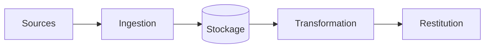

# Entrepôt de Données 
---


Les données publiques sénégalaises sont éparpillées (HDX, Banque mondiale, PAM, ANSD), dans des formats hétérogènes et sans indication de fraîcheur. Ce projet construit l’entrepôt fiable sur lequel s’appuient « Prix alimentaires », « Mobile money » et « Prévision des prix », plus un catalogue public qui dit ce qui existe, à quelle date et avec quelle qualité.

## Résultat

Le chiffre ou la capture qui montre que ça marche (à remplir à la fin).

## Architecture



## Lancer le projet

```bash
make install
make check
```

## Décisions

Les choix importants et leur raison sont dans `docs/decisions.md`.

## Limites

Ce que le projet ne fait pas, et pourquoi.
