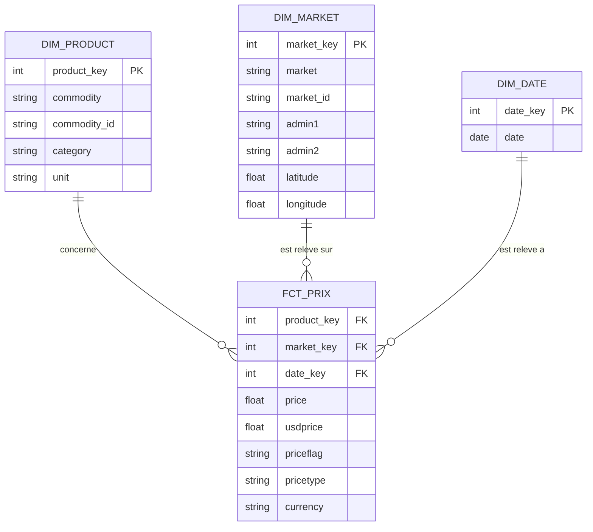
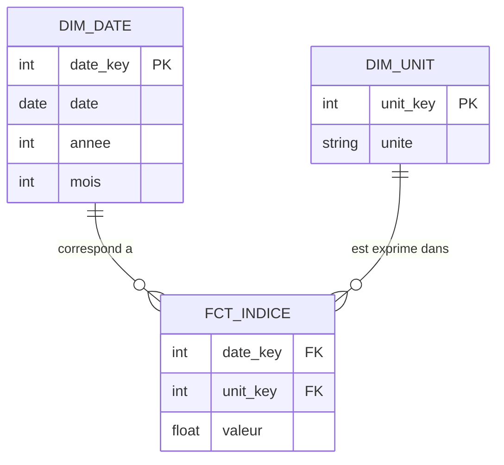
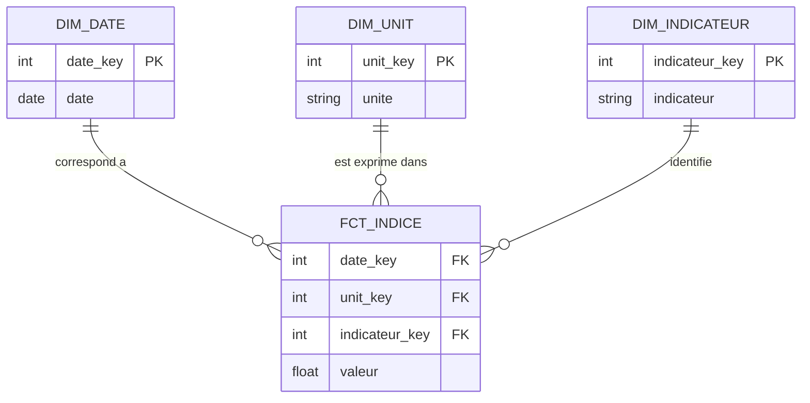

# Liste des modèles pour chaque source
---

## Analyse de la table des prix du PAM
---

Méthodologie : choisir une mesure, déclarer le grain, identifier les dimensions, identifier les faits. 

## 1. Choisir une mesure
---
La mesure est le prix relevé d'un produit

## 2. Déclarer le grain 
---
Le grain représente ce qu'est une ligne de la table de fait. 
Nous définissons ici le grain comme : *le prix d'un produit, dans une unité, pour un type (détail ou gros), dans un marché, sur un mois.*

La requête sql permettant de vérifier que le grain choisi est correct, c'est à dire qu'il ne contient pas de doublons et ne mélange pas plusieurs grain est la suivante : 
```sql
SELECT price, commodity, unit, pricetype, market, date, count(*) AS n
FROM pam_prices
GROUP BY all
HAVING count(*) > 1;
```

## 3. Identification des faits, des dimensions et de leurs attributs
---
Cette partie concerne l'identification des tables de faits, des tables de dimensions ainsi que leurs attributs.
- Identification des faits
  * fct_prix (le prix d'un produit) : price, usdprice
- Identification des dimensions 
  * dim_product (produit) : commodity, commodity_id, category, unit
  * dim_market (marche) : market, market_id, admin1, admin2, latitude, longitude
  * dim_date (date) : date
- *Cas particulier* : attributs du relevé
Les attributs 'priceflag', 'pricetype', et 'currency' sont des attributs du relevé. Ils peuvent être rattachés à la table de faits. 

### 4. Modélisation dimensionnelle

Le schéma suivant représente le modèle en étoile retenu.
Il présente la table de faits centrale et les dimensions qui permettent d'analyser les observations.



## Analyse de la table de l'IHPC (Indice Harmonisé des Prix à la Consommation) de l'ANSD
---

Méthodologie : choisir une mesure, déclarer le grain, identifier les dimensions, identifier les faits.

## 1. Choisir une mesure
---
La mesure est la valeur de l'indice des prix calculé pour les produits alimentaires.

## 2. Déclarer le grain
---
Le grain dit exactement ce qu'est une ligne de la table de fait. 
Nous définissons le grain ici comme : la valeur de l'indice des produits alimentaires, dans une unité, sur un mois. 

La requête SQL permettant de vérifier que le grain choisi est correct, donc qu'il n'y a pas de doublons et pas de mélange de plusieurs grains est la suivante : 
```sql
SELECT indicateurs, Unit, Date, Value, count(*) AS N
FROM ansd_ihpc
GROUP BY all
HAVING count(*) > 1
ORDER BY count(*) DESC;
```

## 3. Identification des faits, des dimensions et de leurs attributs
---
Cette partie concerne l'identification des tables de faits, des tables de dimensions ainsi que leurs attributs.
- Identification des faits
  * fct_indice (la valeur de l'indice des produits alimentaires) : Value
- Identification des dimensions
  * dim_unit (unite) : Unit
  * dim_date (date) : Date

### 4. Modélisation dimensionnelle

Le schéma suivant représente le modèle en étoile retenu.
Il présente la table de faits centrale et les dimensions qui permettent d'analyser les observations.



## Analyse de la table de l'inflation des prix à la consommation (Inflation, Consumer Prices) de la Banque Mondiale
---

Méthodologie : choisir une mesure, déclarer le grain, identifier les dimensions, identifier les faits.

## 1. Choisir une mesure
---
La mesure est la valeur d'un indicateur.

## 2. Déclarer le grain
---
Le grain dit exactement ce que représente une ligne.
Nous définissons le grain ici comme : la valeur d'un indicateur pour un pays, sur une année.

La requête SQL permettant de vérifier que le grain choisi est correct, c'est-à-dire qu'il n'y a pas de doublon ou que plusieurs grains n'ont pas été mélangés est la suivante : 
```sql
SELECT "Country Name", "Indicator Name", Value, count(*) AS N
FROM wb_cpi_annual
GROUP BY ALL
HAVING count(*) > 1
ORDER BY count(*) DESC;
```

Aucun doublon n'a été retourné. 

## 3. Identification des faits, des dimensions et de leurs attributs
---
Cette partie concerne l'identification des tables de faits, des tables de dimensions ainsi que leurs attributs.
- Identification des faits
* fct_inflation (la valeur de l'inflation) : Value
- Identification des dimensions
* dim_indicator (indicateur) : Indicator Name, Indicator Code
* dim_country (pays) : Country Name, Country Code
* dim_date (année) : Year 

### 4. Modélisation dimensionnelle

Le schéma suivant représente le modèle en étoile retenu.
Il présente la table de faits centrale et les dimensions qui permettent d'analyser les observations.
